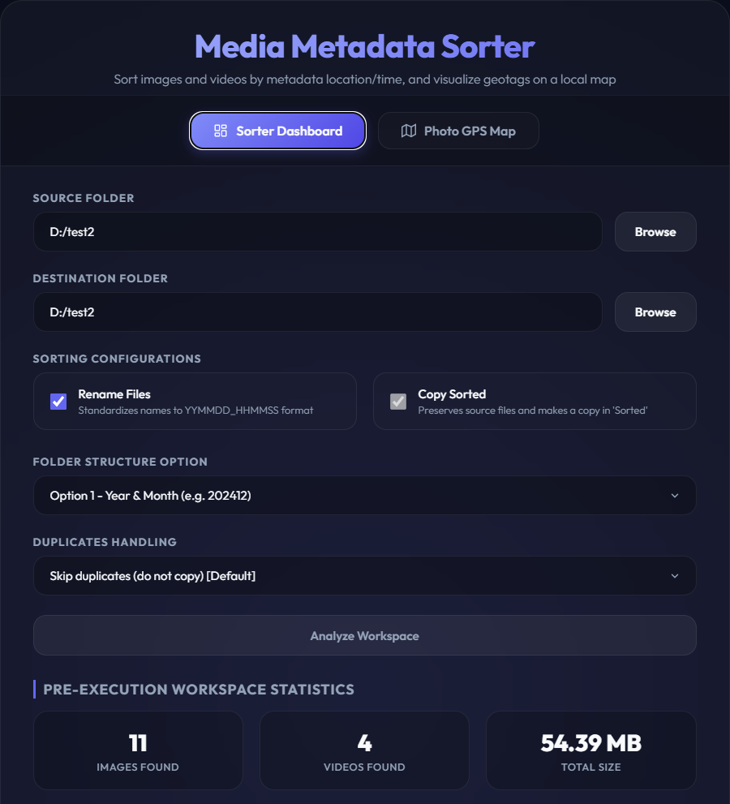
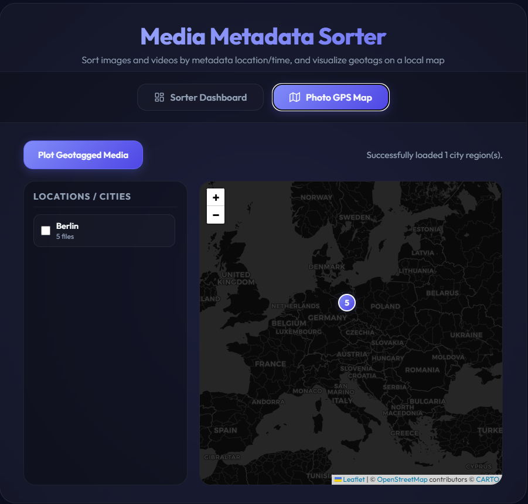

# Media Metadata Sorter

Sorting of images and videos, renaming, geolocation, copy, duplicate removal.




---

## Key Features

1. **Pre-Execution Analysis Phase:**
   * Scans all files and displays detailed file information (Dimensions, Format, Date Taken/Created, Camera Model, GPS location, and proposed new name).
   * Resolves GPS coordinates to city names (e.g., *Berlin*, *Rostock*, *København*) using the Nominatim OpenStreetMap API.
   * Calculates SHA-256 hashes to identify and classify duplicate files.
   * Displays analysis summaries and prompts you for confirmation before making any changes.

2. **Custom Folder Structuring Options:**
   Choose how the destination folders are structured:
   * **Option 1:** Sort by Year & Month (e.g., `Sorted/202412/`) [Default]
   * **Option 2:** Sort by Year (e.g., `Sorted/2024/`)
   * **Option 3:** Sort by Year, Month, and Location (e.g., `Sorted/202412_Berlin/`)
   * **Option 4:** Sort by Year and Location (e.g., `Sorted/2024_Berlin/`)
   * **Option 5:** Sort by Location only (e.g., `Sorted/Berlin/`)

3. **Renaming & Duplicate Copy Toggles:**
   * **Renaming Toggle:** Choose to rename files to a standardized format (`YYMMDD_HHMMSS_City.ext`) or preserve their original filenames.
   * **Duplicates Handling:** Choose to **Skip duplicates** (exclude identical files from copying) or **Keep duplicates** (copy duplicates and resolve filename collisions automatically by appending numeric suffixes like `_1`).
   * **Fallback Folder Majority:** If metadata required for your sorting option is missing (e.g., location is missing under Option 3/4/5), the file will automatically sort into the target folder used by the majority of its neighboring files.

4. **Safe Operation (Non-Destructive):**
   * The script **never** moves, edits, or deletes your original source files. All operations are safe copy actions into the designated `Sorted` folder. Target directory name collisions are resolved automatically using unique suffixes to prevent overwrites.

5. **JSON Execution Summary:**
   * Generates a detailed execution report at `Sorted/summary.json` mapping every processed file, its extracted metadata, rename and duplicate choices, and final sort destinations.

---

## Setup Instructions

To run this project on a new computer:

1. **Create a virtual environment (optional but recommended):**
   ```bash
   python -m venv venv
   ```

2. **Activate the virtual environment:**
   * **Windows (PowerShell):**
     ```powershell
     .\venv\Scripts\Activate.ps1
     ```
   * **Windows (Command Prompt):**
     ```cmd
     .\venv\Scripts\activate.bat
     ```
   * **macOS / Linux:**
     ```bash
     source venv/bin/activate
     ```

3. **Install the dependencies:**
   ```bash
   pip install -r requirements.txt
   ```

## Usage

From the project root directory:

* **Interactive mode (UI directory pickers):**
  ```bash
  python scripting/metadata_sorter.py
  ```

* **CLI mode (specifying the target directory):**
  ```bash
  python scripting/metadata_sorter.py "path/to/your/images_folder"
  ```

---

## Detailed Execution Flow

### Pass 1: Scan & Analysis Phase
Before copying, the script lists every media file and processes its metadata:
```text
(4/14) A1\IMG_0247.JPEG
  Type:          MPO Image
  Dimensions:    1536 x 2048 px
  Date Taken:    2024:11:11 11:25:26
  Camera Model:  Apple iPhone 12 mini
  GPS Location:  52.520881, 13.320072
  Proposed name:  241111_112526_Berlin.jpeg
```
After scanning, it prints a summary of the analyzed metadata:
```text
================================================================================
METADATA ANALYSIS REPORT
================================================================================
Files with both timestamp and location available: 14
Files with only timestamp available:             6
...
================================================================================
Do you want to continue with renaming and copying of files? (y/N): 
```

### Pass 2 & 3: Copying & Sorting Phase
Upon confirmation, files are copied with a live progress bar:
```text
================================================================================
PROCESSING FILES WITH TIMESTAMPS...
================================================================================
Progress: [#################-------------] 59.1% (13/22 files)
```

At the end of copying, it outputs a post-execution workspace summary:
```text
================================================================================
FINAL WORKSPACE SUMMARY (Post-execution)
================================================================================
Images:      18 files (Size: 21.61 MB)
Videos:      4 files (Size: 24.32 MB)
Other files: 0 files (Size: 0 B)
Total:       22 files (Size: 45.93 MB)
--------------------------------------------------------------------------------
Files Renamed:       0
Duplicates Skipped:  22
Files Copied:        22
================================================================================
```
